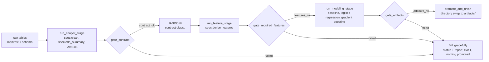

# pulse

A factory for trustworthy prediction models. A **CrewAI Flow** hands off from a **Data Analyst
crew** to a **Data Scientist crew** with deterministic validation gates in between, graceful
failure and byte-reproducible artifacts. The dataset is not part of the core: a `DatasetSpec`
supplies the raw schema, the cleaning rules, the column catalogue, the features, the target and
the split windows, and the pipeline turns it into a validated clean table, a dataset contract, a
model, metrics, a model card and an evaluation report.

Repository: https://github.com/matnael332/pulse

**Status.** The core is dataset-agnostic. `backend/tests/toy_spec.py` is a small seeded spec that exercises every gate, fault, renderer, the
API and the ops copilot end to end. The first real dataset spec is `workforce_saas` (a
time-attendance SaaS; ten data groups, one row per customer account and month, target: cancelled
within 60 days): `backend/pulse_specs/workforce_saas/` holds the schema (`SCHEMA.md`), a seeded
synthetic generator (`uv run synth`, `SYNTH.md`) and the spec (`spec.py`), and the pipeline runs
on it end to end in deterministic mode. The product is a hosted service: customers upload an
export and run the pipeline on our server, one folder per customer (`--data-dir`, `--runs-dir`,
`--artifacts-dir`, `--run-id`). One Docker image runs the pipeline, the dashboard, the API and
the site on that server (`Dockerfile`, `compose.yaml`, `DEPLOY.md`). The site (`web/`, served by
`pulse_server`) signs companies in with Google or Microsoft, in Hebrew or English, and lets an
operator approve them; next: upload and run from the site.

## How it runs



**Run-then-narrate.** Each stage first runs seeded Python that writes every artifact with template
narratives. Only then (in LLM mode) does a crew run: tool-bearing agents read the computed results
and tool-less narrator agents write structured narratives grounded in those numbers. Gates never
depend on LLM behaviour; `--no-llm` makes every artifact spec-complete without a model call.

**The seam.** Producers (`stages`, the contract builder, the feature builder, the Flow, the crew
runner) receive the `DatasetSpec`. Gates, training, fault injection and the raw loader read
everything they need from the artifacts: `feature_spec.json` carries the id, time and split
columns and the decision stage; `dataset_contract.json` carries the feature rules and the split
windows. See `backend/pulse_core/spec.py` for the full interface and the conventions a spec must
honour.

## Verify

```bash
uv sync                                                            # Python 3.13 + locked deps
uv run ruff check . && uv run ruff format --check .
uv run pytest                                                      # 207 tests: toy spec, generator, workforce_saas spec, ingestion, server, worker
uv run synth --data-dir data                                       # workforce_saas raw data: 200 accounts, ~145 MB, < 1 min
uv run python -m pulse_flow.run --no-llm --spec pulse_specs.workforce_saas.spec:SPEC --data-dir data   # full run, promotes to artifacts/
uv run python -m pulse_flow.run --no-llm --spec tests.toy_spec:SPEC --data-dir <toy data> --no-promote
uv run python -m pulse_flow.run --no-llm --no-promote               # no spec: graceful failure, exit 1
uv run streamlit run frontend/streamlit_app.py                     # dashboard (empty until a run is promoted)
uv run pulse-api                                                   # prediction API on http://127.0.0.1:8000
```

A customer's own export (any structure) goes through the ingestion first: it proposes a mapping, a person
approves it, and `apply` writes the data folder, the spec params and the entity map, then deletes the
export. `scramble` turns the synthetic data into an export that looks like a real one (Hebrew, Excel,
a file per month, Israeli dates, personal columns we must not keep):

```bash
uv run python -m pulse_specs.workforce_saas.scramble data/raw --out customer.zip
uv run pulse-ingest propose customer.zip --customer-dir customer [--no-llm]   # prints the mapping to review
uv run pulse-ingest approve --customer-dir customer --ingestion <id>
uv run pulse-ingest apply   --customer-dir customer --ingestion <id>          # prints the pipeline command
```

The site: `pulse-server` (port 8100) serves the API and the built web site (`web/dist`). Locally it
uses a SQLite file in `var/` and customer folders in `customers/`; the dev login stands in for
Google and Microsoft. `PULSE_PUBLIC_URL` must be the address in the browser (writes from any other
origin are refused):

```bash
cd web && npm ci && npm run build && cd ..                         # Node 24; the site into web/dist
PULSE_ENV=development PULSE_DEV_LOGIN=1 PULSE_OPERATOR_EMAILS=ops@example.com \
  uv run pulse-server serve --migrate                              # http://localhost:8100 (API docs: /api/docs)
PULSE_ENV=development uv run pulse-server worker                   # uploads, ingestion, runs (another terminal)
python scripts/server_smoke.py [--demo]                            # signup -> approval (-> the demo's run), end to end
```

While working on the site, `npm run dev` in `web/` serves it on http://localhost:5173 with live
reload and forwards `/api`, `/auth` and `/health` to the server; start the server with
`PULSE_PUBLIC_URL=http://localhost:5173` then. `npm test` (Vitest), `npm run typecheck` and
`npm run format:check` are what CI runs.

The site is Hebrew or English (an English browser opens in English, any other in Hebrew; the
switch is remembered), right-to-left in Hebrew, light or dark like the system, and one page per
state: sign-in, the company's name, waiting for approval (or rejected, suspended), an active
company's pages, and the operator's companies screen.

An active company uploads its export on the site (a zip, up to 1 GB, streamed straight to its
folder) or tries the demo (our scrambled synthetic export, in its own `demo/` folder; a real
upload deletes it). The worker (`pulse-server worker`, one job at a time) proposes a mapping;
the customer sees what was understood (data groups, their tables as ours, the columns left out,
the personal ones among them) and fixes only what was flagged, then approves. The worker prepares
the data and runs the pipeline; the site follows each stage and shows the summary, or the reason
it stopped, worded from a stable code in Hebrew or English. The same structure next month is
approved by itself, unless it brings category spellings the mapping does not know.

A finished run opens on its results. The overview: accounts per risk level, what the language
model found and recommends (in the uploader's language), the accounts at risk with their names,
probability and reasons (filter, search, a CSV for Excel), the risk distribution and the monthly
cancellation rate, and notes on the data (groups missing, the windows, low confidence). The
advanced tab: the model's quality against the others compared, what matters most, the model card
and the evaluation and cleaning reports, the figures, and the company's runs. The results API
(`/api/runs/{id}/results`, `/advanced`, `/docs/...`, `/figures/...`) serves only these, never the
model, the clean data or the scored rows.

A user signs in (`/auth/{google,microsoft}/login`, or `POST /api/auth/dev-login`), names their
company (`POST /api/signup/company`) and waits; an operator (`PULSE_OPERATOR_EMAILS`, verified
address) approves it (`POST /api/admin/companies/{id}/approve`), which creates the company's
customer folder. `/api/me` says where a user stands. The site calls everything under `/api`; only
the sign-in's browser navigations (`/auth/...`) and `/health` live outside it. `.env.example`
lists the `PULSE_*` settings.

The same inside Docker, on the server volume (`DEPLOY.md` has the full guide; CI runs these):

```bash
docker compose build
docker compose run --rm job synth --data-dir /srv/pulse/customers/demo/data/synth
docker compose run --rm job python -m pulse_flow.run --no-llm --spec pulse_specs.workforce_saas.spec:SPEC \
  --data-dir /srv/pulse/customers/demo/data/synth --runs-dir /srv/pulse/customers/demo/runs \
  --artifacts-dir /srv/pulse/customers/demo/artifacts
docker compose up -d                                               # dashboard :8501, API :8000, server :8100 + Postgres (localhost only; .env needs PULSE_SECRET_KEY)
```

The toy data folder is written by `tests.toy_spec.write_raw(<dir>/raw)`; the test suite does this
in a temporary directory. `synth` writes `data/raw/` (13 tables, `raw_schema.json`,
`manifest.json`), `data/truth/` (the planted story, never read by the pipeline) and an empty
`data/lookups/`; `data/` is git-ignored. `--accounts`, `--seed`, `--start-month`, `--snapshot`
and `--dirt` change the dataset, `--force` overwrites it.

| Flag | Meaning |
|---|---|
| `--spec pkg.module:ATTR` | the dataset spec (default: the `PIPELINE_DATASET_SPEC` variable): a `DatasetSpec` or a factory |
| `--spec-params FILE` | JSON keyword arguments for a spec factory, one file per customer (e.g. `make_spec`'s `snapshot_date` and `groups`: the data groups the export holds; the core groups commercial, punches, payroll and usage are required, the others optional) |
| `--no-llm` / `--mode` | deterministic or LLM mode (default: LLM when `GEMINI_API_KEY` is set) |
| `--language en\|he` | language of the LLM narratives (default `en`); templates and report headings stay English, and `narratives.json` records each narrative's source and language |
| `--data-dir` | folder with `raw/` (tables, `raw_schema.json`, `manifest.json`) and `lookups/` |
| `--inject-fault NAME` | `bad_input_hash`, `crew_error`, `drop_column`, `contract_mismatch`, `missing_feature`, `leaky_feature`, `missing_artifact` |
| `--no-promote` | keep the run in `runs/<id>/` only |
| `--from-run ID --start-at features\|modeling` | resume from a previous run's artifacts |
| `--compare-to DIR` | print the reproducibility table against another artifacts folder |

**Exit codes:** 0 success; 1 graceful failure (see `runs/<id>/run_status.json`); 2 unexpected
error (redacted traceback in `runs/<id>/traceback.txt`).

## Repository layout

```
backend/
  pulse_core/        generic pipeline library (no CrewAI): spec, splits, columns, raw, contract,
                     validators (3 gates), features, modeling, reporting, promotion, manifest
  pulse_flow/        CrewAI layer: flow.py, crews/ (YAML + classes), tools/, run.py (CLI)
  pulse_api/         Flask prediction API: record validation from feature_spec.json, risk policy,
                     batch scoring
  pulse_copilot/     Ops copilot: read-only tools, the Gemini loop, instant answers
  pulse_ingest/      ingestion: safe unzip, readers (Excel, cp1255), profile, mapping (rules + LLM on
                     names only), normalisation, pseudonyms, the pulse-ingest CLI, the customer
                     folder layout (layout.py)
  pulse_server/      the site's backend (FastAPI): Google/Microsoft sign-in, sessions, companies
                     and the operator's approval; SQLAlchemy + Alembic (Postgres, SQLite locally)
  tests/             tests + toy_spec.py (the synthetic DatasetSpec they run on)
frontend/            Streamlit dashboard (reads artifacts/ only): copilot, model, contract, runs
web/                 the site (Vite, React, TypeScript, Mantine): pages, he/en dictionaries, theme
scripts/             repository hygiene check, the server's smoke test
Dockerfile           the server image; compose.yaml runs it, DEPLOY.md explains the server
```

`artifacts/` is the contract between the backend and the frontend: it holds the last promoted
run. It is git-ignored, like `data/`: on the server both live in the customer's own folder. Code: MIT (`LICENSE`).
